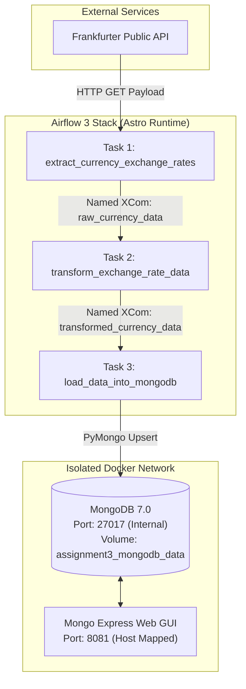

# Automated Airflow ETL Pipeline For Currency Exchange

---

## Project Overview

This project implements an automated, production-ready ETL (Extract, Transform, Load) pipeline using Apache Airflow 3.0 orchestrated via Astronomer's Astro CLI.

The pipeline automates the daily extraction of global currency exchange rates from the public Frankfurter API, validates and transforms records into a standardized JSON contract, and loads the data into a containerized MongoDB database backed by persistent storage and administered via a Mongo Express web GUI.

---

## Architecture and Data Flow



---

## Key Pipeline Features

- **Frankfurter API Ingestion**:
  - Fetches real-time and historical currency rates with EUR as base against USD, GBP, and JPY.
  - Built with timeout handling, user-agent headers, and endpoint fallback mechanisms.

- **Strict Named XCom Data Transfer**:
  - In compliance with assignment rules, tasks never rely on anonymous default return values.
  - `raw_currency_data`: Pushed by Task 1 with raw API payload; pulled by Task 2.
  - `transformed_currency_data`: Pushed by Task 2 containing the standardized documents; pulled by Task 3.

- **Data Contract Compliance**:
  - Transforms API responses into the exact required schema:
    ```json
    {
      "base_currency": "EUR",
      "target_currency": "USD",
      "exchange_rate": 1.0845,
      "rate_date": "2026-11-10",
      "source": "Frankfurter API",
      "retrieved_at": "2026-11-10T22:20:01"
    }
    ```

- **Idempotent Database Loading**:
  - Task 3 performs upsert operations based on compound keys `(base_currency, target_currency, rate_date)` ensuring that re-running DAG runs does not introduce duplicate data.

- **Security and Zero-Credential Policy**:
  - **No Plaintext Passwords**: Zero credentials in Python code, configuration files, or Docker Compose.
  - **Environment Segregation**: Secrets are loaded strictly via `.env` (excluded by `.gitignore` and `.dockerignore`). A sanitized `.env.example` template is tracked for reproduction.
  - **Internal Network Isolation**: Port 27017 is not mapped to the host (`expose: ["27017"]`). Only Airflow and Mongo Express can communicate with MongoDB internally.
  - **Log Masking**: Task execution logs automatically mask database connection credentials.

- **Persistent Storage and Metadata**:
  - Uses named Docker volume `assignment3_mongodb_data` preserving database state across container stop/reboot cycles.
  - All services and volumes carry standardized metadata labels.

---

## Project Structure

```text
Assignment 3/
├── dags/
│   └── currency_exchange_etl.py       # Main 3-task Airflow DAG pipeline
├── .astro/                            # Astro CLI internal project configuration
├── .dockerignore                      # Build context exclusion rules
├── .env.example                       # Sanitized template for environment configuration
├── .gitignore                         # Git tracking exclusion rules
├── Dockerfile                         # Astro Runtime base container definition
├── docker-compose.override.yml        # MongoDB, Mongo Express, Networking & Volumes
├── packages.txt                       # OS-level packages (if needed)
├── requirements.txt                   # Python dependencies (pymongo, requests)
└── README.md                          # Project documentation
```

---

## Getting Started and Reproduction

### Prerequisites
- Docker Desktop (running with WSL2 / Linux engine)
- Astro CLI

### 1. Clone the Repository
```bash
git clone https://github.com/MuhammadSaad-1/23L-0679_A3_Ops.git
cd 23L-0679_A3_Ops
```

### 2. Configure Environment Variables
Copy the sanitized template file to `.env` and supply your own credentials:
```bash
cp .env.example .env
```

### 3. Start the Environment
```bash
astro dev start
```

### 4. Access the Interfaces
- **Airflow Web UI**: [http://localhost:8080](http://localhost:8080)
- **Mongo Express Web UI**: [http://localhost:8081](http://localhost:8081)

### 5. Execute the DAG
1. Log in to the Airflow Web UI.
2. Locate the DAG named **`currency_exchange_etl`**.
3. Toggle the DAG switch to **Active / Unpaused**.
4. Click the **Trigger** button.
5. All three tasks will execute and succeed:
   `extract_currency_exchange_rates` -> `transform_exchange_rate_data` -> `load_data_into_mongodb`.

### 6. Tear Down / Stop
When finished, stop all containers to release system resources:
```bash
astro dev stop
```
